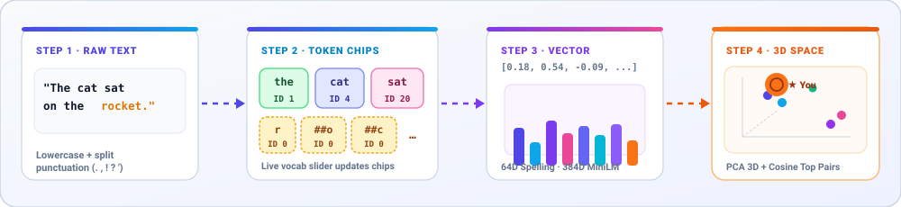
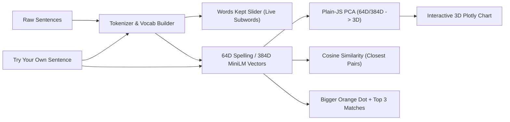

<div align="center">



<br />

[](index.html)
[](index.html)
[](https://plotly.com/javascript/)
[](https://huggingface.co/Xenova/all-MiniLM-L6-v2)

<p>
  <strong>An interactive, beginner-friendly teaching web app that makes the LLM text pipeline visible.</strong><br />
  Watch raw sentences turn into vocabulary IDs, coloured subword chips, high-dimensional vectors, and an interactive 3D scatter plot — all inside a single, readable <code>index.html</code> file.
</p>

</div>

---

## Live Pipeline Overview

<div align="center">
  
</div>



---

## Features Built Across All 7 Stages

<table>
  <tr>
    <td width="50%" valign="top">
      <h3>Part 1 · Tokenizer</h3>
      <ul>
        <li><strong>Vocabulary Builder</strong> — Lowercases text, separates punctuation (<code>. , ! ? '</code>), counts word frequencies, sorts most-frequent first, and assigns IDs starting at <code>0 = [UNK]</code>.</li>
        <li><strong>Coloured Token Chips</strong> — Displays each token with the word on top and its ID below. Colours come deterministically from IDs so repeated words always match.</li>
        <li><strong>Subword Splitting</strong> — Unknown words automatically break into letter pieces (e.g. <code>z</code> <code>##e</code> <code>##b</code> <code>##r</code> <code>##a</code>) with live character/token efficiency stats.</li>
        <li><strong>Live “Words Kept” Slider</strong> — Drag from <code>N</code> down to <code>0</code> to shrink the vocabulary and watch known words shatter into subword pieces in real time.</li>
      </ul>
    </td>
    <td width="50%" valign="top">
      <h3>Part 2 · Embeddings in 3D</h3>
      <ul>
        <li><strong>Spelling-Based Mode (64D)</strong> — Hashes every 3-letter character chunk into a unit-normalized 64-number vector. Instantly shows why <em>"The cat sat on the mat."</em> and <em>"The bat sat on the mat."</em> cluster together.</li>
        <li><strong>Meaning-Based Mode (384D)</strong> — Loads <code>transformers.js</code> (<code>Xenova/all-MiniLM-L6-v2</code>) right in the browser with a live download progress bar and automatic fallback to spelling mode on <code>file://</code>.</li>
        <li><strong>Plain-JS 3D PCA + Plotly.js</strong> — Reduces 64D or 384D vectors to <code>(x, y, z)</code> with dependency-free power iteration PCA, plotted as a rotatable 3D scatter chart with full hover tooltips.</li>
        <li><strong>Closest Pairs &amp; Live Tester</strong> — Ranks the top 5 sentence pairs by full-vector cosine similarity, and lets you add your own sentence as a <strong>bigger orange dot</strong> with its first 8 vector numbers and 3 closest matches.</li>
      </ul>
    </td>
  </tr>
</table>

---

## Quick Start

No `npm install`. No build step. No API keys.

### Option 1 — Instant Open (Tokenizer + Spelling-Based 3D Mode)
Just double-click **`index.html`** to open it in any modern browser.

### Option 2 — Serve Over HTTP (Unlocks Live Meaning-Based AI Mode)
To let the browser download and run `Xenova/all-MiniLM-L6-v2` via `transformers.js`:

```bash
python3 -m http.server 8000
```

Then open **[http://localhost:8000](http://localhost:8000)** in your browser!

> **Automatic Fallback:** If you click **Meaning-based** while viewing via `file://`, the app automatically shows a clear notice and falls back to Spelling-based embeddings so nothing breaks.

---

## Spelling-Based vs. Meaning-Based Embeddings

Try plotting the 8 built-in sentences in both modes to see the core intuition behind modern LLM embeddings:

| Sentence Pair | Spelling-Based (3-gram Hash) | Meaning-Based (`all-MiniLM-L6-v2`) | Why? |
| :--- | :---: | :---: | :--- |
| *"The cat sat on the mat."* ↔ *"The bat sat on the mat."* | **Very Close (`0.903`)** | Medium | Almost identical letters, different animal |
| *"The cat sat on the mat."* ↔ *"A kitten rested on the rug."* | Far (`0.434`) | **Very Close** | Different words, nearly identical meaning |
| *"The stock market crashed today."* ↔ *"Share prices fell sharply."* | Far | **Very Close** | Zero shared words, same financial meaning |
| *"I love programming in Python."* ↔ *"Pythons are large snakes."* | Moderately Close | Farther Apart | Same word *"Python"*, different contexts |

---

<details>
<summary><strong>Deep Dive: How the Code Is Structured (Beginner-Friendly)</strong></summary>

<br />

The entire application lives inside one self-contained file: **[`index.html`](index.html)** (`<style>` + semantic HTML + plain JavaScript `<script>`).

- Every JavaScript section begins with a **`// WHAT THIS DOES:`** comment written in plain, beginner-friendly language.
- **Zero framework boilerplate** — standard DOM APIs, clean helper functions, and shared reusable logic across all 7 stages.
- **Plain-JS PCA** — reduces 64D or 384D embeddings down to `(x, y, z)` using readable loops and power iteration without any math library.

</details>

<details>
<summary><strong>Repository Structure</strong></summary>

<br />

```text
LLM-Pipeline/
├── index.html                  # Complete single-file LLM Pipeline Explorer app
├── README.md                   # Documentation & animated visuals
└── assets/
    ├── hero-banner.svg         # Animated SVG hero banner for README
    └── pipeline-flow.svg       # Animated SVG 4-step pipeline diagram for README
```

</details>

---

<div align="center">
  <sub>Built with plain HTML, CSS, JavaScript, Plotly.js, and Transformers.js — designed for teaching how LLMs see text.</sub>
</div>
